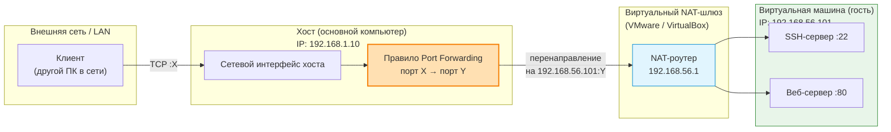

## 1. Цель работы

Изучить принципы работы веб-сервера Apache в связке с PHP-FPM. Освоить настройку виртуальной машины в VirtualBox с SSH-доступом через проброс портов. Научиться настраивать Apache как обратный прокси для PHP-FPM, включать `mod_rewrite` и настраивать `.htaccess` для человекопонятных URL (ЧПУ). Реализовать динамический каталог магазина с категориями, товарами и страницей добавления товара.

## 2. Теоретическая справка

### 2.1. Apache и PHP-FPM: модель взаимодействия

В отличие от Nginx, Apache имеет встроенную поддержку PHP через `mod_php`, но современный подход — вынос PHP в отдельный процесс-менеджер **PHP-FPM** (FastCGI Process Manager). Apache принимает HTTP-запрос, определяет, что запрошен `.php`-файл, и передаёт его через FastCGI в PHP-FPM по Unix-сокету. Тот исполняет скрипт и возвращает результат обратно Apache, который отдаёт его клиенту.

Ключевая директива в конфигурации Apache — `SetHandler` с указанием пути к сокету. Путь обязан совпадать с реальным путём, который слушает PHP-FPM (обычно `/run/php/phpX.X-fpm.sock`). Если пути не совпадают — получите **503 Service Unavailable** (в отличие от 502 у Nginx).

### 2.2. mod_rewrite и ЧПУ

`mod_rewrite` — модуль Apache, который перехватывает входящий URL и перенаправляет его на внутренний скрипт, не меняя адресную строку браузера. Именно это позволяет превратить `/product.php?id=5` в `/catalog/electronics/smartphone-x`.

Правила записываются в файл `.htaccess` (при `AllowOverride All` в конфиге VirtualHost) или напрямую в конфиг сайта. Основные директивы:

- `RewriteEngine On` — включает механизм перезаписи;
- `RewriteCond` — задаёт условие срабатывания;
- `RewriteRule` — само правило перезаписи;
- флаг `[L]` — останавливает обработку дальнейших правил после совпадения;
- флаг `[QSA]` — сохраняет исходные GET-параметры.

### 2.3. Динамический каталог

Динамический каталог — это страницы, содержимое которых формируется из базы данных по запросу, а не хранится в готовых HTML-файлах. В работе используется SQLite (файловая БД, не требует отдельного сервера). Структура: таблица `categories` (категории) и `products` (товары, связанные с категорией через `category_id`). Каждый товар и категория имеют **слаг** — человекочитаемый идентификатор для URL.

### 2.4. VirtualBox NAT и проброс портов

В режиме NAT виртуальная машина не видна из внешней сети. Проброс портов создаёт правило: «трафик, пришедший на порт X хоста, перенаправить на порт Y гостя». Это позволяет подключаться к ВМ по SSH и открывать её веб-сервисы с основного компьютера.

**Критически важно:** не пробрасывать порт 80 хоста. Если занять порт 80 на хосте, браузер основного ПК будет обращаться к VirtualBox вместо интернета, и сайты перестанут открываться. Используйте нестандартный порт, например 8080.

## 3. Оборудование и программное обеспечение

- Основной компьютер с установленным VirtualBox.
- ISO-образ Ubuntu Server ([https://ubuntu.com/download/server](https://ubuntu.com/download/server)).
- SSH-клиент на хосте (терминал Linux/macOS, PuTTY для Windows).

## 4. Ход выполнения работы

### Задание 0. Создание ВМ и настройка SSH-доступа

**Шаг 1. Создание виртуальной машины.** В VirtualBox нажмите «Создать»:

- Имя: `Apache-PHP-Lab`
- Тип: Linux, Версия: Ubuntu (64-bit)
- Память: 2048 МБ
- Диск: VDI, динамический, 20 ГБ

**Шаг 2. Настройка сети и проброс портов.** Настройки ВМ → «Сеть» → Адаптер 1:

- Тип подключения: **NAT**
- Разверните «Дополнительно» → «Проброс портов»

|Имя|Протокол|Порт хоста|Порт гостя|Назначение|
|---|---|---|---|---|
|SSH|TCP|2222|22|SSH-доступ к ВМ|
|HTTP|TCP|8080|80|Веб-сервисы Apache|

Не используйте порт 80 в поле «Порт хоста» — это заблокирует доступ к сайтам на основном компьютере.

**Шаг 3. Установка Ubuntu Server.** Запустите ВМ с ISO-образом. При установке обязательно отметьте галочку «Install OpenSSH server».

**Шаг 4. Подключение по SSH с хоста.**

bash

ssh username@localhost -p 2222

Замените `username` на имя пользователя, созданное при установке. Все дальнейшие команды выполняются в этом SSH-сеансе.

### Задание 1. Установка Apache + PHP-FPM

**Шаг 1. Установка пакетов.**

bash

sudo apt update
sudo apt install -y apache2 php-fpm php-cli php-mbstring php-xml php-curl php-zip composer sqlite3

**Шаг 2. Проверка версии и пути к сокету.**

bash

php -v
ls /run/php/

Вы увидите файл вида `php8.3-fpm.sock` (версия зависит от Ubuntu). Запишите это имя — оно критически важно для следующего шага.

**Шаг 3. Включение модулей и отключение mod_php.**

bash

sudo a2dismod php8.3 2>/dev/null
sudo a2enmod proxy proxy_fcgi rewrite
sudo systemctl restart apache2

`mod_rewrite` здесь ключевой — именно он будет отвечать за ЧПУ.

### Задание 2. Настройка VirtualHost с поддержкой ЧПУ

**Шаг 1. Создание каталога сайта.**

bash

sudo mkdir -p /var/www/shop/data
sudo chown -R $USER:www-data /var/www/shop

**Шаг 2. Конфигурация VirtualHost.**

Создайте файл `/etc/apache2/sites-available/shop.conf`:

apache

<VirtualHost *:80>
    ServerName localhost
    DocumentRoot /var/www/shop
    <Directory /var/www/shop>
        Options Indexes FollowSymLinks
        AllowOverride All
        Require all granted
    </Directory>
    <FilesMatch \.php$>
        SetHandler "proxy:unix:/run/php/php8.3-fpm.sock|fcgi://localhost"
    </FilesMatch>
    ErrorLog ${APACHE_LOG_DIR}/shop_error.log
    CustomLog ${APACHE_LOG_DIR}/shop_access.log combined
</VirtualHost>

Замените `php8.3-fpm.sock` на вашу версию из Задания 1. Ключевая строка — `AllowOverride All`. Без неё Apache проигнорирует `.htaccess`, и ЧПУ не заработают.

**Шаг 3. Активация и проверка.**

bash

sudo a2ensite shop.conf
sudo a2dissite 000-default.conf
sudo apachectl configtest
sudo systemctl reload apache2

Должно вывести `Syntax OK`.

### Задание 3. Структура динамического каталога и база данных

**Шаг 1. Создание базы SQLite.**

bash

sqlite3 /var/www/shop/data/shop.db

Внутри SQLite выполните:

sql

CREATE TABLE categories (
    id INTEGER PRIMARY KEY,
    slug TEXT UNIQUE,
    name TEXT
);
CREATE TABLE products (
    id INTEGER PRIMARY KEY,
    category_id INTEGER,
    slug TEXT,
    name TEXT,
    price REAL,
    description TEXT,
    FOREIGN KEY(category_id) REFERENCES categories(id)
);
INSERT INTO categories (slug, name) VALUES 
('electronics', 'Электроника'),
('books', 'Книги');
INSERT INTO products (category_id, slug, name, price, description) VALUES
(1, 'smartphone-x', 'Смартфон X', 29999.00, 'Мощный смартфон с отличной камерой'),
(1, 'laptop-pro', 'Ноутбук Pro', 74999.00, 'Ноутбук для работы и творчества'),
(2, 'php-book', 'PHP для профессионалов', 1500.00, 'Лучшая книга по PHP');

Выйдите из SQLite (`.quit`). Права на файл БД:

bash

sudo chown www-data:www-data /var/www/shop/data/shop.db
sudo chmod 664 /var/www/shop/data/shop.db
sudo chown www-data:www-data /var/www/shop/data

### Задание 4. Файл `.htaccess` и правила ЧПУ

Создайте `/var/www/shop/.htaccess`:

apache

RewriteEngine On
RewriteBase /
# Если запрошен реальный файл или каталог — отдаём как есть
RewriteCond %{REQUEST_FILENAME} -f [OR]
RewriteCond %{REQUEST_FILENAME} -d
RewriteRule ^ - [L]
# Админка: добавление товара
RewriteRule ^admin/add-product/?$ admin_add_product.php [L,QSA]
# Главная страница каталога
RewriteRule ^catalog/?$ index.php [L,QSA]
# Категория: /catalog/electronics
RewriteRule ^catalog/([a-z0-9-]+)/?$ category.php?slug=$1 [L,QSA]
# Товар: /catalog/electronics/smartphone-x
RewriteRule ^catalog/([a-z0-9-]+)/([a-z0-9-]+)/?$ product.php?category_slug=$1&product_slug=$2 [L,QSA]

Логика: если файл существует — отдаём напрямую. Иначе перенаправляем на PHP-скрипты, передавая слаги как GET-параметры. Правило админки стоит **раньше** правила `/catalog/...`, чтобы не перехватиться им.

### Задание 5. PHP-скрипты каталога

**`/var/www/shop/index.php`** (главная — список категорий):

php

<?php
$db = new PDO('sqlite:' . __DIR__ . '/data/shop.db');
$categories = $db->query("SELECT * FROM categories")->fetchAll(PDO::FETCH_ASSOC);
?>
<h2>Каталог магазина</h2>
<ul>
<?php foreach ($categories as $cat): ?>
    <li>
        <a href="/catalog/<?= htmlspecialchars($cat['slug']) ?>">
            <?= htmlspecialchars($cat['name']) ?>
        </a>
    </li>
<?php endforeach; ?>
</ul>

<a href="/admin/add-product">+ Добавить товар</a>

**`/var/www/shop/category.php`** (товары в категории):

php

<?php
$db = new PDO('sqlite:' . __DIR__ . '/data/shop.db');
$slug = $_GET['slug'] ?? '';
$stmt = $db->prepare("SELECT * FROM categories WHERE slug = ?");
$stmt->execute([$slug]);
$category = $stmt->fetch(PDO::FETCH_ASSOC);
if (!$category) { http_response_code(404); die('Категория не найдена'); }
$stmt = $db->prepare("SELECT * FROM products WHERE category_id = ?");
$stmt->execute([$category['id']]);
$products = $stmt->fetchAll(PDO::FETCH_ASSOC);
?>
<h2><?= htmlspecialchars($category['name']) ?></h2>
<ul>
<?php foreach ($products as $p): ?>
    <li>
        <a href="/catalog/<?= htmlspecialchars($slug) ?>/<?= htmlspecialchars($p['slug']) ?>">
            <?= htmlspecialchars($p['name']) ?> — <?= number_format($p['price'], 0, '', ' ') ?> ₽
        </a>
    </li>
<?php endforeach; ?>
</ul>

<a href="/">Назад к категориям</a>

**`/var/www/shop/product.php`** (карточка товара):

php

<?php
$db = new PDO('sqlite:' . __DIR__ . '/data/shop.db');
$catSlug = $_GET['category_slug'] ?? '';
$prodSlug = $_GET['product_slug'] ?? '';
$stmt = $db->prepare("
    SELECT p.*, c.name as category_name, c.slug as category_slug
    FROM products p
    JOIN categories c ON p.category_id = c.id
    WHERE c.slug = ? AND p.slug = ?
");
$stmt->execute([$catSlug, $prodSlug]);
$product = $stmt->fetch(PDO::FETCH_ASSOC);
if (!$product) { http_response_code(404); die('Товар не найден'); }
?>
<h2><?= htmlspecialchars($product['name']) ?></h2>

<strong>Категория:</strong> <?= htmlspecialchars($product['category_name']) ?>

<strong>Цена:</strong> <?= number_format($product['price'], 0, '', ' ') ?> ₽

<?= htmlspecialchars($product['description']) ?>

    <a href="/catalog/<?= htmlspecialchars($product['category_slug']) ?>">Назад в категорию</a> |
    <a href="/">На главную</a>

### Задание 6. Страница добавления товара

**`/var/www/shop/admin_add_product.php`**:

php

<?php
$db = new PDO('sqlite:' . __DIR__ . '/data/shop.db');
$db->setAttribute(PDO::ATTR_ERRMODE, PDO::ERRMODE_EXCEPTION);
$errors = [];
$categories = $db->query("SELECT * FROM categories ORDER BY name")->fetchAll(PDO::FETCH_ASSOC);
if ($_SERVER['REQUEST_METHOD'] === 'POST') {
    $categoryId = (int)($_POST['category_id'] ?? 0);
    $name       = trim($_POST['name'] ?? '');
    $slug       = trim($_POST['slug'] ?? '');
    $price      = (float)($_POST['price'] ?? 0);
    $desc       = trim($_POST['description'] ?? '');
    if ($categoryId <= 0) {
        $errors[] = 'Выберите категорию.';
    }
    if ($name === '') {
        $errors[] = 'Название товара обязательно.';
    }
    if ($slug === '') {
        $errors[] = 'Слаг (URL) обязателен.';
    } elseif (!preg_match('/^[a-z0-9-]+$/', $slug)) {
        $errors[] = 'Слаг может содержать только строчные латинские буквы, цифры и дефис.';
    }
    if ($price <= 0) {
        $errors[] = 'Цена должна быть больше нуля.';
    }
    if (!$errors) {
        $stmt = $db->prepare("SELECT COUNT(*) FROM products WHERE category_id = ? AND slug = ?");
        $stmt->execute([$categoryId, $slug]);
        if ($stmt->fetchColumn() > 0) {
            $errors[] = 'Товар с таким слагом уже есть в этой категории.';
        }
    }
    if (!$errors) {
        try {
            $stmt = $db->prepare("
                INSERT INTO products (category_id, slug, name, price, description)
                VALUES (?, ?, ?, ?, ?)
            ");
            $stmt->execute([$categoryId, $slug, $name, $price, $desc]);
            $stmt = $db->prepare("SELECT slug FROM categories WHERE id = ?");
            $stmt->execute([$categoryId]);
            $catSlug = $stmt->fetchColumn();
            header("Location: /catalog/{$catSlug}/{$slug}");
            exit;
        } catch (PDOException $e) {
            $errors[] = 'Ошибка БД: ' . $e->getMessage();
        }
    }
}
?>
<!DOCTYPE html>
<html lang="ru">
<head>
    <meta charset="UTF-8">
    <title>Добавить товар</title>
</head>
<body>
<h2>Добавить товар в каталог</h2>
<?php if ($errors): ?>
    

        <ul>
            <?php foreach ($errors as $e): ?>
                <li><?= htmlspecialchars($e) ?></li>
            <?php endforeach; ?>
        </ul>
    

<?php endif; ?>
<form method="post" action="/admin/add-product">
    

        <label>Категория: 
            <select name="category_id">
                <option value="0">— выберите —</option>
                <?php foreach ($categories as $cat): ?>
                    <option value="<?= $cat['id'] ?>"
                        <?= (($_POST['category_id'] ?? 0) == $cat['id']) ? 'selected' : '' ?>>
                        <?= htmlspecialchars($cat['name']) ?>
                    </option>
                <?php endforeach; ?>
            </select>
        </label>
    

    

        <label>Название: 
            <input type="text" name="name" value="<?= htmlspecialchars($_POST['name'] ?? '') ?>" required>
        </label>
    

    

        <label>Слаг (URL): 
            <input type="text" name="slug" value="<?= htmlspecialchars($_POST['slug'] ?? '') ?>"
                   pattern="[a-z0-9-]+" title="Только строчные латинские буквы, цифры и дефис" required>
        </label>
    

    

        <label>Цена (₽): 
            <input type="number" step="0.01" min="0.01" name="price"
                   value="<?= htmlspecialchars($_POST['price'] ?? '') ?>" required>
        </label>
    

    

        <label>Описание: 
            <textarea name="description" rows="4" cols="50"><?= htmlspecialchars($_POST['description'] ?? '') ?></textarea>
        </label>
    

    

        <button type="submit">Сохранить товар</button>
        <a href="/">Отмена</a>
    

</form>
</body>
</html>

**Как это работает:** при отправке формы данные приходят POST-запросом. Скрипт валидирует поля (категория, название, слаг по регулярке `[a-z0-9-]+`, цена > 0, отсутствие дубля слага в категории). При успехе — `INSERT` в SQLite и **редирект** на карточку нового товара (PRG-паттерн, защита от повторной отправки формы при обновлении страницы).

### Задание 7. Проверка с хоста

Открой в браузере на основном компьютере:

1. `http://localhost:8080/` — список категорий и ссылка «+ Добавить товар».
    
2. Нажми на «Электроника» → `http://localhost:8080/catalog/electronics` со списком товаров.
    
3. Нажми на «Смартфон X» → `http://localhost:8080/catalog/electronics/smartphone-x` с карточкой.
    
4. Перейди на `http://localhost:8080/admin/add-product`, добавь товар (например, категория «Книги», название «Чистый код», слаг `clean-code`, цена `2000`) → должен произойти редирект на `http://localhost:8080/catalog/books/clean-code`.
    
5. Попробуй добавить товар с уже существующим слагом — должна появиться ошибка валидации.
    

**Если видишь 404 или 500:**

- Проверь, что `AllowOverride All` стоит в VirtualHost.
    
- Проверь синтаксис `.htaccess` (лишние пробелы, опечатки в регулярках).
    
- Посмотри `sudo tail -f /var/log/apache2/shop_error.log`.
    

**Если видишь 503 Service Unavailable:**

- Проверь, запущен ли PHP-FPM: `systemctl status php8.3-fpm`.
    
- Совпадает ли путь к сокету в `SetHandler` с реальным файлом в `/run/php/`.
    

## 5. Контрольные вопросы и ответы

**1. В чём разница между прямым и обратным прокси?**  
Прямой прокси стоит на стороне клиента и скрывает клиента от сервера (например, корпоративный прокси для выхода в интернет). Обратный прокси стоит на стороне сервера и скрывает бэкенд-серверы от клиента, принимая все запросы и распределяя их.

**2. Зачем нужны заголовки X-Forwarded-For и X-Real-IP?**  
Без них бэкенд-приложение видит только IP-адрес прокси (127.0.0.1), а не реального клиента. Эти заголовки передают исходный IP, что необходимо для логирования, аналитики и защиты.

**3. Какой алгоритм балансировки нагрузки используется в Apache по умолчанию?**  
В `mod_proxy_balancer` по умолчанию используется **byrequests** (по количеству запросов), а не Round Robin, как в Nginx. Это важное отличие.

**4. Почему для PHP в Apache используется PHP-FPM, а не mod_php?**  
PHP-FPM — это отдельный процесс-менеджер, который эффективнее встраивания PHP в веб-сервер: он изолирует PHP-воркеры, позволяет управлять пулами и лучше масштабируется. `mod_php` загружает интерпретатор в каждый процесс Apache, что расходует память.

**5. Зачем нужен `mod_rewrite` и как он связан с ЧПУ?**  
`mod_rewrite` перехватывает входящий URL и перенаправляет его на внутренний скрипт, не меняя адресную строку браузера. Именно это позволяет превратить `/product.php?id=5` в `/catalog/electronics/smartphone-x`.

**6. Что произойдёт, если в VirtualHost не указать `AllowOverride All`?**  
Apache проигнорирует `.htaccess`, и все правила ЧПУ останутся неработающими. Запросы к «красивым» URL будут возвращать 404.

**7. Чем отличается `RewriteRule` от `RewriteCond`?**  
`RewriteCond` задаёт условие (например, «запрошенный файл не существует»), а `RewriteRule` — само правило перезаписи, которое срабатывает только при выполнении всех предшествующих условий.

**8. Почему в правилах используется флаг `[L]`?**  
Он говорит Apache: «если это правило совпало — останови обработку дальнейших правил». Без `[L]` следующее правило может перезаписать результат предыдущего.

**9. Что произойдёт, если в `SetHandler` указать неверный путь к сокету?**  
Apache не сможет подключиться к PHP-FPM и вернёт клиенту ошибку **503 Service Unavailable** (в отличие от 502 у Nginx). Путь к сокету должен точно совпадать с тем, что слушает PHP-FPM (проверяется через `ls /run/php/`).

**10. Зачем после успешного `INSERT` делать редирект, а не просто выводить сообщение «Товар добавлен»?**  
Потому что без редиректа при обновлении страницы браузер повторно отправит POST-запрос, и товар добавится дважды. Редирект по PRG-паттерну переводит браузер на GET-запрос карточки, и повторная загрузка страницы уже безопасна.

**11. Почему нельзя пробрасывать порт 80 хоста в VirtualBox?**  
Порт 80 на хосте используется браузером для доступа к сайтам по HTTP. Если VirtualBox займёт этот порт, браузер будет перенаправлять запросы в виртуальную машину вместо интернета.

## 6. Критерии оценивания (шкала оценок)

Лабораторная работа оценивается по 100-балльной шкале с переводом в академическую оценку.

### 6.1. Критерии оценивания отчёта

|Баллы|Критерий|
|---|---|
|85–100|Отчёт содержит все разделы в полном объёме: цель, теория, листинги конфигураций с комментариями, скриншоты всех проверок (главная, категория, карточка товара, форма добавления, успешное добавление, `apachectl configtest`), ответы на все контрольные вопросы, выводы. Оформление аккуратное, конфигурации читаемы.|
|75–84|Отчёт содержит все разделы, но один-два раздела раскрыты неполно (например, отсутствует скриншот формы добавления или ответ на один вопрос неполный). Конфигурации присутствуют, но без комментариев.|
|65–74|Отчёт содержит не все разделы: отсутствуют скриншоты проверок, или конфигурации приведены без пояснений, или ответы на вопросы даны частично.|
|0–64|Отчёт отсутствует или содержит менее половины требуемых разделов. Конфигурации нерабочие или скопированы без понимания.|

### 6.2. Критерии оценивания защиты (устный опрос)

|Баллы|Критерий|
|---|---|
|85–100|Правильные и полные ответы на два контрольных вопроса. Студент демонстрирует понимание принципов работы Apache + PHP-FPM и `mod_rewrite`, а не просто заученные команды.|
|75–84|Правильный и полный ответ на один вопрос, правильный но неполный — на второй.|
|65–74|Правильный и неполный ответ только на один вопрос.|
|0–64|Отсутствие правильных ответов на вопросы.|

## 7. Требования к отчёту

- Титульный лист (дисциплина, номер и название работы, ФИО студента и проверяющего).
    
- Цель работы.
    
- Теоретическая часть (краткий конспект по Apache, PHP-FPM, `mod_rewrite`, ЧПУ).
    
- Листинги конфигураций с комментариями:
    
    - `shop.conf` (VirtualHost);
        
    - `.htaccess`;
        
    - `index.php`, `category.php`, `product.php`, `admin_add_product.php`;
        
    - SQL-схема базы.
        
- Скриншоты:
    
    - Главная страница `http://localhost:8080/` со списком категорий;
        
    - Страница категории `/catalog/electronics`;
        
    - Карточка товара `/catalog/electronics/smartphone-x`;
        
    - Форма добавления товара `/admin/add-product`;
        
    - Форма с ошибкой валидации (дубль слага или пустое поле);
        
    - Карточка только что созданного товара по ЧПУ-адресу;
        
    - Вывод команды `sudo apachectl configtest` (Syntax OK);
        
    - Вывод `ls /run/php/` (подтверждение наличия сокета).
        
- Ответы на контрольные вопросы (письменно).
    
- Выводы (что изучено, какие навыки получены).