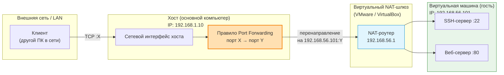

  ## 1. Цель работы

Изучить принципы работы веб-сервера Nginx и связки с PHP-FPM. Освоить настройку виртуальной машины в VirtualBox с SSH-доступом через проброс портов. Научиться настраивать Nginx как обратный прокси и балансировщик нагрузки для PHP-приложений, а также проксировать WebSocket-соединения на примере PHP-чата.

## 2. Теоретическая справка

### 2.1. Nginx и PHP-FPM: модель взаимодействия

В отличие от Apache с модулем mod_php, где PHP встраивается непосредственно в процесс веб-сервера, Nginx не умеет исполнять PHP-код самостоятельно. PHP-FPM (FastCGI Process Manager) — это отдельный процесс-менеджер, который запускает пул PHP-воркеров и общается с Nginx через Unix-сокет или TCP-порт . Nginx принимает HTTP-запрос, определяет, что запрошен .php-файл, и передаёт его через FastCGI в PHP-FPM. Тот исполняет скрипт и возвращает результат обратно Nginx, который отдаёт его клиенту.

Ключевая директива в конфигурации Nginx — fastcgi_pass. Путь к сокету в ней обязан совпадать с реальным путём, который слушает PHP-FPM (обычно /run/php/phpX.X-fpm.sock). Если пути не совпадают — получите 502 Bad Gateway .

### 2.2. Обратный прокси и балансировка нагрузки

Обратный прокси принимает запросы от клиентов и перенаправляет их на бэкенд-серверы. Директива proxy_pass задаёт адрес назначения. Заголовки X-Real-IP и X-Forwarded-For передают бэкенду реальный IP клиента, а не IP прокси.

Балансировка нагрузки распределяет запросы между несколькими серверами через блок upstream. По умолчанию Nginx использует Round Robin — поочерёдную передачу запросов каждому серверу в пуле.


### 2.3. WebSocket и Nginx

WebSocket — протокол двунаправленной связи поверх TCP. Для его проксирования через Nginx требуются три обязательные директивы :

```nginx
proxy_http_version 1.1;

proxy_set_header Upgrade $http_upgrade;

proxy_set_header Connection "upgrade";
```

Без proxy_http_version 1.1 механизм Upgrade (переключение протокола с HTTP на WebSocket) не сработает, и соединение останется обычным HTTP. Дополнительно proxy_read_timeout увеличивают, чтобы Nginx не разрывал долгоживущее соединение при простое.

### 2.4. VirtualBox NAT и проброс портов

В режиме NAT виртуальная машина не видна из внешней сети. Проброс портов (Port Forwarding) создаёт правило: «трафик, пришедший на порт X хоста, перенаправить на порт Y гостя» . Это позволяет подключаться к ВМ по SSH и открывать её веб-сервисы с основного компьютера.



Критически важно: не пробрасывать порт 80 хоста. Если занять порт 80 на хосте, браузер основного ПК будет обращаться к VirtualBox вместо интернета, и сайты перестанут открываться. Используйте нестандартный порт, например 8080.

## 3. Оборудование и программное обеспечение

| Компонент   | Требование                               |
| ----------- | ---------------------------------------- |
| Хостовая ОС | Windows / Linux / macOS                  |
| Гипервизор  | Oracle VirtualBox 7.x                    |
| Гостевая ОС | Ubuntu Server 22.04 / 24.04 LTS          |
| Пакеты в ВМ | openssh-server, nginx, php-fpm, composer |

## 4. Ход выполнения работы

### Задание 0. Создание ВМ и настройка SSH-доступа

#### Шаг 1. Создание виртуальной машины.

В VirtualBox нажмите «Создать»:

	Имя: Nginx-PHP-Lab
	Тип: Linux, Версия: Ubuntu (64-bit)
	Память: 2048 МБ
	Диск: VDI, динамический, 20 ГБ

#### Шаг 2. Настройка сети и проброс портов.

Настройки ВМ → «Сеть» → Адаптер 1:
	Тип подключения: NAT
	![[Pasted image 20261031110939.png]]

Разверните «Дополнительно» → «Проброс портов»
                       
![[Pasted image 20261031111131.png]]
 
| Имя  | Протокол | Порт хоста | Порт гостя | Назначение        |
| ---- | -------- | ---------- | ---------- | ----------------- |
| SSH  | TCP      | 2222       | 22         | SSH-доступ к ВМ   |
| HTTP | TCP      |  8080      | 80         | Веб-сервисы Nginx |

Не используйте порт 80 в поле «Порт хоста» — это заблокирует доступ к сайтам на основном компьютере.
#### Шаг 3. Установка Ubuntu Server.

Запустите ВМ с ISO-образом. При установке обязательно отметьте галочку «Install OpenSSH server» — это избавит от ручной настройки SSH после установки.

https://ubuntu.com/download/server
#### Шаг 4. Подключение по SSH с хоста.

```bash
ssh username@localhost -p 2222
```
localhost = 127.0.0.1
или при помощи Pytty 

Замените username на имя пользователя, созданное при установке. Все дальнейшие команды выполняются в этом SSH-сеансе.

### Задание 1. Установка PHP-FPM (Глава 0 — установка PHP)

Пояснение: PHP-FPM устанавливается до Nginx, чтобы сразу знать версию и путь к сокету.

**Шаг 1.** Установка PHP и расширений.

Обновление списка пакетов
```bash
sudo apt update
```
Установка PHP-FPM и базовых расширений

php-fpm — сам менеджер процессов (обязателен для Nginx)

остальные — часто нужны в реальных проектах
```bash
sudo apt install -y php-fpm php-cli php-mbstring php-xml php-curl php-zip
```
**Шаг 2.** Проверка версии и пути к сокету.


Проверяем, какая версия PHP установилась
```bash
php -v
```
Смотрим, какой сокет создал PHP-FPM

Запомните имя файла — оно понадобится в конфиге Nginx

ls /run/php/

Вы увидите файл вида php8.1-fpm.sock или php8.3-fpm.sock (версия зависит от Ubuntu). Запишите это имя — оно критически важно для следующего шага .

**Шаг 3.** Установка Composer (менеджер зависимостей PHP).

Composer понадобится позже для установки библиотеки Ratchet (WebSocket-чат).

```bash


# Установка Composer из репозитория Ubuntu

sudo apt install -y composer

# Проверка

composer --version

Если версия Composer в репозитории устарела, можно установить актуальную :

bash

curl -sS https://getcomposer.org/installer | php

sudo mv composer.phar /usr/local/bin/composer
```
### Задание 2. Настройка Nginx + PHP-FPM (обратный прокси для PHP)

**Шаг 1.** Установка Nginx.

```bash


# Установка веб-сервера

sudo apt install -y nginx

# Запуск и автозагрузка

sudo systemctl start nginx

sudo systemctl enable nginx

# Проверка статуса — должно быть active (running)

sudo systemctl status nginx
```
**Шаг 2.** Создание тестового PHP-сайта.

```bash


# Создаём директорию для сайта

sudo mkdir -p /var/www/phpapp

# Даём текущему пользователю права на запись

sudo chown -R $USER:www-data /var/www/phpapp

# Создаём тестовый файл с phpinfo()

# phpinfo() выводит всю информацию о PHP — идеально для проверки

echo "<?php phpinfo(); ?>" > /var/www/phpapp/index.php
```
**Шаг 3.** Конфигурация Nginx для PHP.

```bash

sudo nano /etc/nginx/sites-available/phpapp
```

Вставьте конфигурацию (замените php8.1-fpm.sock на вашу версию из Шага 2):

```nginx

server {

    listen 80;

    server_name _;

    # Корневая директория сайта

    root /var/www/phpapp;

    index index.php index.html;

    # Обработка статических файлов и ЧПУ

    location / {

        try_files $uri $uri/ =404;

    }

    # Передача PHP-запросов в PHP-FPM

    location ~ \.php$ {

        # Стандартный сниппет Nginx для FastCGI

        include snippets/fastcgi-php.conf;

        # ПУТЬ К СОКЕТУ — должен совпадать с реальным!

        # Если не совпадает → 502 Bad Gateway

        fastcgi_pass unix:/run/php/php8.1-fpm.sock;

    }

    # Запрет доступа к .htaccess и подобным файлам

    location ~ /\.ht {

        deny all;

    }

}
```

**Шаг 4.** Активация и проверка.


```bash

# Создаём симлинк в sites-enabled (активация сайта)

sudo ln -s /etc/nginx/sites-available/phpapp /etc/nginx/sites-enabled/

# Удаляем дефолтный сайт, чтобы он не перехватывал запросы

sudo rm /etc/nginx/sites-enabled/default

# Проверка синтаксиса конфигурации

sudo nginx -t

# Применение конфигурации без остановки сервера

sudo systemctl reload nginx
```

**Шаг 5.** Проверка с хостовой машины.

Откройте в браузере на вашем компьютере:


```text
http://localhost:8080
```
Вы должны увидеть страницу phpinfo() с информацией о PHP и Nginx. Это подтверждает, что связка «Nginx → PHP-FPM» работает .

Если видите 502 Bad Gateway: проверьте, запущен ли PHP-FPM (systemctl status php8.1-fpm) и совпадает ли путь к сокету в fastcgi_pass с реальным файлом в /run/php/.

### Задание 3. Балансировка нагрузки для PHP (Upstream)

**Шаг 1.** Создание второго пула PHP-FPM.


```bash

# Копируем конфигурацию стандартного пула

sudo cp /etc/php/8.1/fpm/pool.d/www.conf /etc/php/8.1/fpm/pool.d/pool2.conf
```

Отредактируйте pool2.conf:


```bash

sudo nano /etc/php/8.1/fpm/pool.d/pool2.conf
```
Измените имя пула и путь к сокету (первые строки файла):


```ini

[pool2]

listen = /run/php/php8.1-fpm-pool2.sock
```
Перезапустите PHP-FPM:

```bash

sudo systemctl restart php8.1-fpm

ls /run/php/  # Должны увидеть два сокета
```

**Шаг 2.** Настройка Nginx с upstream.

Отредактируйте конфигурацию phpapp:

```nginx

# Блок upstream — пул бэкендов для балансировки

upstream php_backends {

    server unix:/run/php/php8.1-fpm.sock;

    server unix:/run/php/php8.1-fpm-pool2.sock;

}

server {

    listen 80;

    server_name _;

    root /var/www/phpapp;

    index index.php index.html;

    location / {

        try_files $uri $uri/ =404;

    }

    location ~ \.php$ {

        include snippets/fastcgi-php.conf;

        # Передаём запросы в пул, а не в конкретный сокет

        fastcgi_pass php_backends;

    }

}
```

**Шаг 3.** Применение и проверка.

```bash

sudo nginx -t && sudo systemctl reload nginx

curl http://localhost:8080
```

Nginx будет поочерёдно направлять PHP-запросы в оба пула (Round Robin). Визуально с phpinfo() это не видно, но конфигурация демонстрирует принцип работы upstream.

### Задание 4. WebSocket-чат на PHP через Nginx

**Шаг 1.** Установка Ratchet (PHP WebSocket библиотека).

```bash

# Создаём директорию для чат-сервера

mkdir -p /var/www/chat && cd /var/www/chat

# Устанавливаем Ratchet через Composer

# cboden/ratchet — популярная библиотека для WebSocket на PHP

composer require cboden/ratchet
```

**Шаг 2.** Создание WebSocket-сервера чата.

Создайте файл /var/www/chat/server.php:

```php


<?php

// Подключаем автозагрузчик Composer (он загрузит Ratchet)

require __DIR__ . '/vendor/autoload.php';

use Ratchet\MessageComponentInterface;

use Ratchet\ConnectionInterface;

use Ratchet\Server\IoServer;

use Ratchet\Http\HttpServer;

use Ratchet\WebSocket\WsServer;

// Класс чата — реализует логику рассылки сообщений

class Chat implements MessageComponentInterface {

    // Хранилище всех подключённых клиентов

    protected $clients;

    public function __construct() {

        $this->clients = new \SplObjectStorage;

    }

    // Вызывается при подключении нового клиента

    public function onOpen(ConnectionInterface $conn) {

        $this->clients->attach($conn);

        echo "Новое подключение: {$conn->resourceId}\n";

    }

    // Вызывается при получении сообщения от клиента

    public function onMessage(ConnectionInterface $from, $msg) {

        // Рассылаем сообщение ВСЕМ клиентам (включая отправителя)

        foreach ($this->clients as $client) {

            $client->send("Пользователь {$from->resourceId}: {$msg}");

        }

    }

    // Вызывается при отключении клиента

    public function onClose(ConnectionInterface $conn) {

        $this->clients->detach($conn);

    }

    // Вызывается при ошибке

    public function onError(ConnectionInterface $conn, \Exception $e) {

        $conn->close();

    }

}

// Запуск сервера на порту 8082

// IoServer — ядро, HttpServer — HTTP-обёртка, WsServer — WebSocket-протокол

$server = IoServer::factory(

    new HttpServer(

        new WsServer(

            new Chat()

        )

    ),

    8082

);

echo "WebSocket чат запущен на порту 8082...\n";

$server->run();
```

Запустите сервер в фоне:

```bash

cd /var/www/chat && php server.php &
```

**Важно:** Ratchet — это долгоживущий PHP-процесс. Он не работает через PHP-FPM. Это отдельный демон, который слушает свой порт и обслуживает WebSocket-соединения напрямую.

**Шаг 3.** HTML-страница чата.

Создайте файл /var/www/phpapp/chat.html:

```html

<!DOCTYPE html>

<html>

<head><title>PHP WebSocket Chat</title></head>

<body>

<h2>Чат через Nginx + PHP (Ratchet)</h2>

<!-- Область для сообщений -->

<div id="messages" style="border:1px solid #ccc; height:300px; overflow-y:scroll; padding:10px;"></div>

<br>

<input id="msg" type="text" placeholder="Введите сообщение..." style="width:300px;">

<button onclick="send()">Отправить</button>

<script>

    // Подключаемся к WebSocket через Nginx (порт 8080 хоста → порт 80 ВМ)

    // location.host = localhost:8080

    var ws = new WebSocket("ws://" + location.host + "/ws");

    // При получении сообщения от сервера — добавляем в ленту

    ws.onmessage = function(event) {

        var div = document.getElementById("messages");

        div.innerHTML += "<div>" + event.data + "</div>";

        div.scrollTop = div.scrollHeight;  // Автопрокрутка вниз

    };

    // Отправка сообщения

    function send() {

        var input = document.getElementById("msg");

        if (input.value) {

            ws.send(input.value);

            input.value = "";  // Очистка поля

        }

    }

</script>

</body>

</html>
```

**Шаг 4.** Конфигурация Nginx для WebSocket.

Отредактируйте /etc/nginx/sites-available/phpapp, 
добавив блок для WebSocket внутрь server { }:

```nginx

# ... предыдущие location ...

# WebSocket-чат через Ratchet

location /ws {

    # Проксируем на Ratchet-сервер (порт 8082)

    proxy_pass http://127.0.0.1:8082;

    # ОБЯЗАТЕЛЬНО для WebSocket:

    proxy_http_version 1.1;                    # Upgrade работает только в HTTP/1.1

    proxy_set_header Upgrade $http_upgrade;     # Передаём заголовок Upgrade

    proxy_set_header Connection "upgrade";      # Переключаем соединение

    # Таймаут: WebSocket-соединение долгоживущее

    # Без этого Nginx разорвёт его через 60 секунд простоя

    proxy_read_timeout 3600s;

    proxy_set_header Host $host;

}
```

**Шаг 5.** Применение и проверка.

```bash
sudo nginx -t
sudo systemctl reload nginx
```

Откройте в браузере на хостовой машине:

http://localhost:8080/chat.html

Введите сообщение и нажмите «Отправить». Если сообщение появляется в ленте с префиксом «Пользователь N:», значит WebSocket-соединение успешно проходит через Nginx к Ratchet-серверу. Откройте страницу во второй вкладке — сообщения должны быть видны обоим клиентам.

##  5. Контрольные вопросы и ответы

1. В чём разница между прямым и обратным прокси?

Прямой прокси стоит на стороне клиента и скрывает клиента от сервера (например, корпоративный прокси для выхода в интернет). Обратный прокси стоит на стороне сервера и скрывает бэкенд-серверы от клиента, принимая все запросы и распределяя их.

2. Зачем нужны заголовки X-Forwarded-For и X-Real-IP?

Без них бэкенд-приложение видит только IP-адрес прокси (127.0.0.1), а не реального клиента. Эти заголовки передают исходный IP, что необходимо для логирования, аналитики и защиты.

3. Какой алгоритм балансировки нагрузки используется в Nginx по умолчанию?

Round Robin — поочерёдная передача запросов каждому серверу в пуле upstream.

4. Почему для PHP в Nginx используется PHP-FPM, а не встроенный модуль?

Nginx не имеет встроенной поддержки PHP. PHP-FPM — это отдельный процесс-менеджер, который эффективнее встраивания PHP в веб-сервер: он изолирует PHP-воркеры, позволяет управлять пулами и лучше масштабируется .

5. Какие три директивы обязательны для проксирования WebSocket через Nginx?

proxy_http_version 1.1, proxy_set_header Upgrade $http_upgrade, proxy_set_header Connection "upgrade". Без них Nginx не выполнит переключение протокола, и WebSocket-соединение не установится .

6. Что произойдёт, если в fastcgi_pass указать неверный путь к сокету?

Nginx не сможет подключиться к PHP-FPM и вернёт клиенту ошибку 502 Bad Gateway. Путь к сокету должен точно совпадать с тем, что слушает PHP-FPM (проверяется через ls /run/php/).

7. Почему для Ratchet-сервера нужен отдельный процесс, а не PHP-FPM?

PHP-FPM предназначен для обработки короткоживущих HTTP-запросов: он принимает запрос, исполняет скрипт, возвращает ответ и освобождает воркер. WebSocket-сервер должен держать соединение открытым неограниченно долго и поддерживать состояние (список клиентов). Это не соответствует модели PHP-FPM, поэтому Ratchet запускается как отдельный долгоживущий демон.

8. Почему нельзя пробрасывать порт 80 хоста в VirtualBox?

Порт 80 на хосте используется браузером для доступа к сайтам по HTTP. Если VirtualBox займёт этот порт, браузер будет перенаправлять запросы в виртуальную машину вместо интернета, и сайты перестанут открываться.

##  6. Критерии оценивания (шкала оценок)

Лабораторная работа оценивается по 100-балльной шкале с переводом в академическую оценку .

### 6.1. Критерии оценивания отчёта

| Баллы  | Критерий                                                                                                                                                                                                                                                   |
| ------ | ---------------------------------------------------------------------------------------------------------------------------------------------------------------------------------------------------------------------------------------------------------- |
| 85–100 | Отчёт содержит все разделы в полном объёме: цель, теория, листинги конфигураций с комментариями, скриншоты всех проверок (phpinfo, чат в двух вкладках, nginx -t), ответы на все контрольные вопросы, выводы. Оформление аккуратное, конфигурации читаемы. |
| 75–84  | Отчёт содержит все разделы, но один-два раздела раскрыты неполно (например, отсутствует скриншот балансировки или ответ на один вопрос неполный). Конфигурации присутствуют, но без комментариев.                                                          |
| 65–74  | Отчёт содержит не все разделы: отсутствуют скриншоты проверок, или конфигурации приведены без пояснений, или ответы на вопросы даны частично.                                                                                                              |
| 0–64   | <br>     Отчёт отсутствует или содержит менее половины требуемых разделов. Конфигурации нерабочие или скопированы без понимания.                                                                                                                           |
###  6.2. Критерии оценивания защиты (устный опрос)


| Баллы  | Критерий                                                                                                                                                       |
| ------ | -------------------------------------------------------------------------------------------------------------------------------------------------------------- |
| 85–100 | <br> Правильные и полные ответы на два контрольных вопроса. Студент демонстрирует понимание принципов работы Nginx+PHP-FPM, а не просто заученные команды.<br> |
| 75–84  | Правильный и полный ответ на один вопрос, правильный но неполный — на второй.                                                                                  |
| 65–74  | Правильный и неполный ответ только на один вопрос.                                                                                                             |
| 0–64   | Отсутствие правильных ответов на вопросы.                                                                                                                      |

### 6.3. Итоговая оценка

| Сумма баллов | Академическая оценка |
| ------------ | -------------------- |
| 85–100       | Отлично              |
| 75–84        | Хорошо               |
| 65–74        | Удовлетворительно    |
| 0–64         | Неудовлетворительно  |
## 7. Требования к отчёту

·         Титульный лист (дисциплина, номер и название работы, ФИО студента и проверяющего).

·         Цель работы.

·         Теоретическая часть (краткий конспект по Nginx, PHP-FPM, WebSocket).

·         Листинги конфигураций (Nginx phpapp, pool2.conf, server.php) с комментариями.

·         Скриншоты:

·         Страница phpinfo() по адресу http://localhost:8080;

·         Страница чата chat.html с отправленным и полученным сообщением (желательно — в двух вкладках);

·         Вывод команды sudo nginx -t (успешная проверка синтаксиса);

·         Вывод ls /run/php/ (подтверждение наличия сокетов).

·         Ответы на контрольные вопросы (письменно).

·         Выводы (что изучено, какие навыки получены).