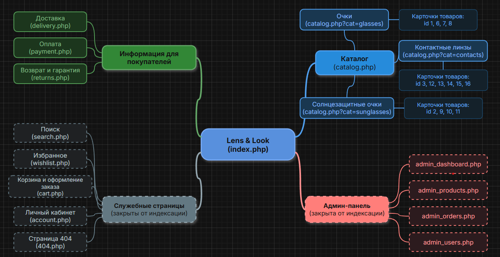

## 2. Выбор тематики и проектирование структуры

### 2.1. Тематика и цели сайта

Для работы послужил интернет-магазин оптики «Lens & Look», созданный в рамках курсового проекта на 3 курсе. В магазине продаются очки для зрения, солнцезащитные очки и контактные линзы. Сайт написан на PHP, данные хранятся в базе MySQL (`lens_look`).

Цель сайта состоит в продаже товаров через интернет: покупатель выбирает товар в каталоге, добавляет его в корзину и оформляет заказ. Для удобства предусмотрены поиск и избранное, а условия покупки вынесены на отдельные страницы «Доставка», «Оплата» и «Возврат». Помимо этого есть личный кабинет покупателя и админ-панель для сотрудников магазина.

### 2.2. Типы контента

На сайте присутствуют следующие типы контента:

- главная страница с блоками «Новые поступления», «Популярное», отзывами и часто задаваемыми вопросами;
- три категории каталога: очки, контактные линзы и солнцезащитные очки;
- карточки товаров, всего 14 штук;
- информационные страницы о доставке, оплате и возврате;
- служебные страницы (корзина, избранное, личный кабинет, поиск, страница 404);
- страницы администратора.

### 2.3. Ключевые страницы

К ключевым относятся главная страница (`index.php`), каталог (`catalog.php`) с категориями, карточка товара (`product.php?id=N`) и три информационные страницы. Именно они должны находиться в поисковой выдаче. Корзина, личный кабинет, избранное, поиск и админ-панель содержат личные данные пользователей или повторяют уже существующий контент, поэтому в `robots.txt` они закрыты от индексации.

## 3. Схема навигации (MindMap)



## 4. Иерархия страниц (таблица)

| Раздел | Подраздел | Пример URL | changefreq | priority |
| --- | --- | --- | --- | --- |
| Главная | – | https://lenslook.ru/ | daily | 1.0 |
| Каталог | Все товары | https://lenslook.ru/catalog.php | daily | 0.9 |
| Каталог | Очки | https://lenslook.ru/catalog.php?cat=glasses | weekly | 0.8 |
| Каталог | Контактные линзы | https://lenslook.ru/catalog.php?cat=contacts | weekly | 0.8 |
| Каталог | Солнцезащитные очки | https://lenslook.ru/catalog.php?cat=sunglasses | weekly | 0.8 |
| Товары | Популярные товары (11 шт.) | https://lenslook.ru/product.php?id=1 | weekly | 0.7 |
| Товары | Остальные товары (3 шт.: id 11, 13, 16) | https://lenslook.ru/product.php?id=13 | monthly | 0.6 |
| Информация | Доставка | https://lenslook.ru/delivery.php | monthly | 0.5 |
| Информация | Оплата | https://lenslook.ru/payment.php | monthly | 0.5 |
| Информация | Возврат и гарантия | https://lenslook.ru/returns.php | monthly | 0.4 |

Значения в таблице подбирались исходя из того, как часто меняются страницы и насколько они важны для магазина.

- `priority` уменьшается по мере вложенности: у главной 1.0, у каталога 0.9, у категорий 0.8, у карточек товаров 0.6 и 0.7, у информационных страниц 0.4 и 0.5.
- `changefreq`: главная и каталог обновляются чаще всех, так как там появляются новые поступления, меняются остатки и цены. Категории и карточки в среднем обновляются раз в неделю, а условия доставки, оплаты и возврата меняются редко.
- `lastmod` взят из дат последнего изменения файлов проекта.

## 5. Файл sitemap.xml

В карту вошли 22 адреса: главная страница, каталог, три категории, 14 карточек товаров и три информационные страницы. Все адреса абсолютные и начинаются с `https://`. Служебные и административные страницы в карту не добавлялись. Символ `&` в адресах не встречается, поэтому экранировать его (`&amp;`) не потребовалось.

```xml
<?xml version="1.0" encoding="UTF-8"?>
<urlset xmlns="http://www.sitemaps.org/schemas/sitemap/0.9">
  <url>
    <loc>https://lenslook.ru/</loc>
    <lastmod>2026-06-16</lastmod>
    <changefreq>daily</changefreq>
    <priority>1.0</priority>
  </url>
  <url>
    <loc>https://lenslook.ru/catalog.php</loc>
    <lastmod>2026-06-17</lastmod>
    <changefreq>daily</changefreq>
    <priority>0.9</priority>
  </url>
  <url>
    <loc>https://lenslook.ru/catalog.php?cat=glasses</loc>
    <lastmod>2026-06-17</lastmod>
    <changefreq>weekly</changefreq>
    <priority>0.8</priority>
  </url>
  <url>
    <loc>https://lenslook.ru/catalog.php?cat=contacts</loc>
    <lastmod>2026-06-17</lastmod>
    <changefreq>weekly</changefreq>
    <priority>0.8</priority>
  </url>
  <url>
    <loc>https://lenslook.ru/catalog.php?cat=sunglasses</loc>
    <lastmod>2026-06-17</lastmod>
    <changefreq>weekly</changefreq>
    <priority>0.8</priority>
  </url>
  <url>
    <loc>https://lenslook.ru/product.php?id=1</loc>
    <lastmod>2026-06-16</lastmod>
    <changefreq>weekly</changefreq>
    <priority>0.7</priority>
  </url>
  <url>
    <loc>https://lenslook.ru/product.php?id=6</loc>
    <lastmod>2026-06-16</lastmod>
    <changefreq>weekly</changefreq>
    <priority>0.7</priority>
  </url>
  <url>
    <loc>https://lenslook.ru/product.php?id=7</loc>
    <lastmod>2026-06-16</lastmod>
    <changefreq>weekly</changefreq>
    <priority>0.7</priority>
  </url>
  <url>
    <loc>https://lenslook.ru/product.php?id=8</loc>
    <lastmod>2026-06-16</lastmod>
    <changefreq>weekly</changefreq>
    <priority>0.7</priority>
  </url>
  <url>
    <loc>https://lenslook.ru/product.php?id=3</loc>
    <lastmod>2026-06-16</lastmod>
    <changefreq>weekly</changefreq>
    <priority>0.7</priority>
  </url>
  <url>
    <loc>https://lenslook.ru/product.php?id=12</loc>
    <lastmod>2026-06-16</lastmod>
    <changefreq>weekly</changefreq>
    <priority>0.7</priority>
  </url>
  <url>
    <loc>https://lenslook.ru/product.php?id=13</loc>
    <lastmod>2026-06-16</lastmod>
    <changefreq>monthly</changefreq>
    <priority>0.6</priority>
  </url>
  <url>
    <loc>https://lenslook.ru/product.php?id=14</loc>
    <lastmod>2026-06-16</lastmod>
    <changefreq>weekly</changefreq>
    <priority>0.7</priority>
  </url>
  <url>
    <loc>https://lenslook.ru/product.php?id=15</loc>
    <lastmod>2026-06-16</lastmod>
    <changefreq>weekly</changefreq>
    <priority>0.7</priority>
  </url>
  <url>
    <loc>https://lenslook.ru/product.php?id=16</loc>
    <lastmod>2026-06-16</lastmod>
    <changefreq>monthly</changefreq>
    <priority>0.6</priority>
  </url>
  <url>
    <loc>https://lenslook.ru/product.php?id=2</loc>
    <lastmod>2026-06-16</lastmod>
    <changefreq>weekly</changefreq>
    <priority>0.7</priority>
  </url>
  <url>
    <loc>https://lenslook.ru/product.php?id=9</loc>
    <lastmod>2026-06-16</lastmod>
    <changefreq>weekly</changefreq>
    <priority>0.7</priority>
  </url>
  <url>
    <loc>https://lenslook.ru/product.php?id=10</loc>
    <lastmod>2026-06-16</lastmod>
    <changefreq>weekly</changefreq>
    <priority>0.7</priority>
  </url>
  <url>
    <loc>https://lenslook.ru/product.php?id=11</loc>
    <lastmod>2026-06-16</lastmod>
    <changefreq>monthly</changefreq>
    <priority>0.6</priority>
  </url>
  <url>
    <loc>https://lenslook.ru/delivery.php</loc>
    <lastmod>2026-06-25</lastmod>
    <changefreq>monthly</changefreq>
    <priority>0.5</priority>
  </url>
  <url>
    <loc>https://lenslook.ru/payment.php</loc>
    <lastmod>2026-06-16</lastmod>
    <changefreq>monthly</changefreq>
    <priority>0.5</priority>
  </url>
  <url>
    <loc>https://lenslook.ru/returns.php</loc>
    <lastmod>2026-06-16</lastmod>
    <changefreq>monthly</changefreq>
    <priority>0.4</priority>
  </url>
</urlset>
```

Синтаксис файла был проверен локально с помощью `xmllint`: ошибок нет, кодировка UTF-8. Готовый файл находится в корне репозитория: sitemap.xml. Проверка в онлайн-валидаторе описана в разделе 7.

## 6. Связь sitemap.xml с robots.txt

Файл `robots.txt` расположен в корне сайта и в корне репозитория: robots.txt. Директива `Sitemap` сообщает поисковым роботам адрес карты сайта, а директивы `Disallow` закрывают служебные страницы, которых в карте нет.

```
User-agent: *
Disallow: /account.php
Disallow: /cart.php
Disallow: /wishlist.php
Disallow: /search.php
Disallow: /404.php
Disallow: /admin_
Disallow: /ajax_
Disallow: /includes/
Disallow: /sql/
Disallow: /debug.log

Sitemap: https://lenslook.ru/sitemap.xml
```

## 7. Загрузка и проверка

Сайт написан на PHP и работает с MySQL, поэтому для запуска использовался локальный сервер Open Server. GitHub Pages для такого проекта не подходит, так как PHP там не выполняется. Исходный код сайта размещён в репозитории на GitHub, а файлы `sitemap.xml` и `robots.txt` лежат в корне репозитория рядом с `index.php`. Инструкция по запуску сайта приведена в файле README.md

Порядок размещения и проверки на публичном сайте:

1. Загрузить `sitemap.xml` и `robots.txt` в корневую папку сайта (`public_html` или аналогичную).
2. Открыть в браузере `https://ваш-домен/sitemap.xml` и `https://ваш-домен/robots.txt`. Оба файла должны открываться без ошибок.
3. Проверить `sitemap.xml` на [xml-sitemaps.com](https://www.xml-sitemaps.com/validate-xml-sitemap.html) или в [Яндекс.Вебмастере](https://webmaster.yandex.ru/tools/sitemap/).

## 8. Добавление карты сайта в поисковые системы

Сайт запускался локально, поэтому отправка карты в поисковые системы не выполнялась: они не имеют доступа к адресу `http://lens/`. Ниже описан порядок действий для сайта, размещённого на хостинге с доменом.

**Google Search Console**

1. Войти в [Google Search Console](https://search.google.com/search-console) и добавить ресурс (домен или префикс URL), подтвердив права на сайт.
2. В меню слева открыть раздел «Файлы Sitemap».
3. В поле нового файла ввести `sitemap.xml` и нажать «Отправить».
4. Убедиться, что у файла статус «Успешно», а число обнаруженных страниц равно 22.

**Яндекс.Вебмастер**

1. Войти в [Яндекс.Вебмастер](https://webmaster.yandex.ru/) и добавить сайт, подтвердив права.
2. Открыть раздел «Индексирование» и далее «Файлы Sitemap».
3. Указать адрес `https://ваш-домен/sitemap.xml` и добавить файл.
4. Дождаться обработки и проверить, что ошибок нет.

Индексирование занимает от нескольких часов до нескольких дней, поэтому сразу после отправки статус может быть «В обработке».

## 9. Ответы на контрольные вопросы

**1. Что такое структура сайта и как она влияет на SEO и UX?**

Структура сайта представляет собой иерархию страниц и разделов, а также связи между ними. Для посетителя она определяет удобство навигации: нужный товар должен находиться в двух-трёх кликах от главной страницы. Для поисковых систем понятная структура и внутренняя перелинковка облегчают обход сайта и помогают выстроить категории под поисковые запросы.

**2. Для чего нужен файл sitemap.xml?**

Файл `sitemap.xml` содержит список адресов сайта для поисковых систем. С его помощью новые и глубоко вложенные страницы находятся быстрее. Индексацию карта не гарантирует, она лишь помогает роботу найти страницы.

**3. Какие теги обязательны в sitemap.xml?**

Обязательными являются теги `<urlset>` (корневой элемент), `<url>` (описание одной страницы) и `<loc>` (адрес страницы). Теги `<lastmod>`, `<changefreq>` и `<priority>` можно не указывать.

**4. Что означают `<lastmod>`, `<changefreq>`, `<priority>`?**

- `<lastmod>` содержит дату последнего значимого изменения страницы в формате ГГГГ-ММ-ДД.
- `<changefreq>` показывает, как часто страница обновляется (`always`, `hourly`, `daily`, `weekly`, `monthly`, `yearly`, `never`).
- `<priority>` задаёт важность страницы относительно других страниц того же сайта, от 0.0 до 1.0 (по умолчанию 0.5).

По заявлению Google, значения `changefreq` и `priority` им игнорируются, а `lastmod` учитывается при условии, что даты достоверны. Яндекс воспринимает эти теги как рекомендации.

**5. Почему `<loc>` должен быть абсолютным URL?**

Протокол sitemap требует полный адрес с протоколом и доменом, например `https://lenslook.ru/catalog.php`. По относительному пути робот не сможет точно определить, к какому сайту относится страница. Адрес также должен совпадать с основным вариантом сайта: тот же протокол и тот же домен, с `www` или без него.

**6. Как правильно связать sitemap.xml и robots.txt?**

В файл `robots.txt` добавляется строка `Sitemap: https://ваш-домен/sitemap.xml` с полным адресом. Директива не привязана к `User-agent`, поэтому её можно разместить в любом месте файла, чаще всего в конце. Если карт несколько, строк `Sitemap` тоже будет несколько.

**7. Каковы ограничения файла sitemap.xml по размеру и количеству URL?**

В одном файле допускается не более 50 000 адресов, а его размер без сжатия не должен превышать 50 МБ. Файл можно упаковать в `.gz`, но лимит всё равно считается по размеру до сжатия. Если ограничения превышены, карту разбивают на несколько файлов.

**8. Что такое Sitemap Index? Когда его использовать?**

Sitemap Index представляет собой файл-оглавление со списком нескольких карт сайта (корневой элемент `<sitemapindex>`, внутри него теги `<sitemap>` с `<loc>` и `<lastmod>`). Его используют, когда адресов больше 50 000 или файл слишком большой, а также для удобства, например чтобы хранить отдельно карты товаров, категорий и статей.

**9. Как учитывать многоязычность (hreflang)?**

Для многоязычного сайта в sitemap у каждой страницы перечисляются все её языковые версии с помощью элемента `<xhtml:link rel="alternate" hreflang="..." href="..."/>`. В корневой элемент при этом добавляется пространство имён `xmlns:xhtml="http://www.w3.org/1999/xhtml"`. Каждая языковая версия должна ссылаться на все остальные и на саму себя. Пример:

```xml
<url>
  <loc>https://example.com/ru/</loc>
  <xhtml:link rel="alternate" hreflang="ru" href="https://example.com/ru/"/>
  <xhtml:link rel="alternate" hreflang="en" href="https://example.com/en/"/>
</url>
```

**10. Какие ошибки мешают индексации URL из sitemap.xml?**

- страница закрыта в `robots.txt` или имеет метатег `noindex`;
- страница отдаёт ошибку 404 или 5xx либо перенаправляет на другой адрес (редирект 301 или 302);
- в карте указаны неканонические адреса или дубли (другой протокол, `www`, лишние параметры);
- в `<loc>` указан относительный адрес или адрес другого домена;
- не экранированы спецсимволы (`&` нужно писать как `&amp;`), нарушен синтаксис XML или кодировка не UTF-8;
- превышены лимиты по размеру и количеству адресов;
- сам файл недоступен по адресу или отдаётся с ошибкой.

**11. Как формировать sitemap.xml для динамических разделов (новости, каталог)?**

Карту для динамических разделов лучше генерировать скриптом, который берёт список страниц из базы данных. В проекте для этого подходят таблицы `categories` и `products`: из категорий получаются адреса вида `catalog.php?cat=slug`, а из товаров адреса вида `product.php?id=ID`. Скрипт может сразу отдавать XML по адресу `sitemap.xml` (через правило в `.htaccess`) или записывать файл по расписанию. В `<lastmod>` подставляется дата обновления записи. Пример такого генератора на PHP:

```php
<?php
header('Content-Type: application/xml; charset=UTF-8');
require 'includes/db.php';
$base = 'https://lenslook.ru';
echo '<?xml version="1.0" encoding="UTF-8"?>' . "\n";
echo '<urlset xmlns="http://www.sitemaps.org/schemas/sitemap/0.9">' . "\n";
foreach ($pdo->query('SELECT id, created_at FROM products') as $p) {
    echo "  <url><loc>$base/product.php?id={$p['id']}</loc>"
       . '<lastmod>' . date('Y-m-d', strtotime($p['created_at'])) . '</lastmod></url>' . "\n";
}
echo '</urlset>';
```

Если страниц станет больше 50 000, генератор разбивают на несколько файлов и добавляют Sitemap Index.

**12. Когда нужно использовать отдельные карты: для изображений, видео или новостей?**

- Карта изображений нужна, когда картинки важны для поиска и должны показываться в выдаче по картинкам, например фотографии товаров. Теги `<image:image>` можно добавить прямо в основную карту.
- Карта видео нужна, если на сайте есть видео для видеопоиска (теги `<video:video>` с названием, описанием и ссылкой на файл или плеер).
- Карта новостей предназначена для новостных сайтов, зарегистрированных в Google News. В неё включаются статьи не старше двух дней.

Для магазина «Lens & Look» имеет смысл карта изображений товаров, так как фотографии из папки `assets/images/` составляют важную часть карточек.

## 10. Вывод

В ходе лабораторной работы была спроектирована структура интернет-магазина «Lens & Look» и составлена таблица иерархии страниц. На её основе создан файл `sitemap.xml` на 22 адреса, в котором значения `priority` и `changefreq` подобраны с учётом важности и частоты обновления страниц. Служебные и административные страницы закрыты в `robots.txt`, а адрес карты сайта указан директивой `Sitemap`. Сайт запускался локально на Open Server, а его код вместе с файлами `sitemap.xml`, `robots.txt` и этим отчётом размещён в репозитории на GitHub. Чтобы отправить карту в Google Search Console и Яндекс.Вебмастер, сайт необходимо разместить на хостинге с доменом.
